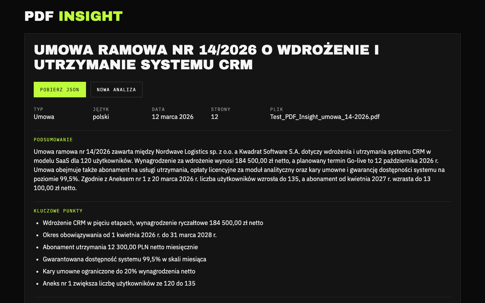

# PDF Insight

**Demo:** https://planetoida90210.github.io/pdf-insight/



## Architektura

```
GitHub Pages (React + Vite)          DigitalOcean (FastAPI, Docker)               OpenRouter
pdf.js: walidacja, miniatury         POST /api/extract (PDF + tekst OCR)        Claude Haiku 5.5
tesseract.js: OCR skanów       →     pdfplumber + filtr ukrytego tekstu
                                     Tesseract dla stron bez tekstu OCR
                               →   POST /api/analyze {extractionId}     →     structured output
Zod → widok, JSON, historia          walidacja Pydantic, 1 retry, grounding
```

- Dwa kroki API, bo UI pokazuje postęp (odczyt tekstu → analiza AI), a ponowienie powtarza tylko krok, który padł.
  Tekst zostaje na serwerze (cache 15 min); `/api/analyze` przyjmuje tylko id, więc nie da się go użyć jako
  darmowego proxy do LLM.
- Jeden schemat wyniku: Pydantic (backend) → `schema/analysis.schema.json`; Zod (frontend) waliduje odpowiedź przed
  wyświetleniem. Wspólne fixtures w `schema/fixtures/` testują oba walidatory.

## Decyzje

- **Ukryty tekst.** Testowy PDF ma na stronie 4 biały tekst na białym tle z instrukcją dla AI. Backend renderuje
  stronę i usuwa znaki, które nie są widoczne w pikselach (a nie „białe znaki”, bo brief ma biały tekst na ciemnym
  tle). Usunięty fragment trafia do ostrzeżeń, nie do modelu.
- **Prompt injection.** Treść dokumentu idzie do modelu jako dane w znaczniku z losowym id; system prompt zabrania
  wykonywania instrukcji z dokumentu; regex zgłasza podejrzane frazy; odpowiedź to wyłącznie JSON wg schematu.
- **Grounding.** Kwoty i daty, których nie ma w tekście źródłowym, są usuwane (z ostrzeżeniem).
- **OCR per strona, w przeglądarce.** Serwer ma 1 współdzielony vCPU (Tesseract 3-5 s na stronę), więc skany czyta
  tesseract.js (`pol+eng`) w kilku workerach przeglądarki i wysyła tekst razem z PDF. O tym, która strona wymaga OCR
  (mało tekstu, znaki bez Unicode, obraz pod krótkim tekstem), decyduje serwer; strony bez tekstu z przeglądarki czyta
  sam Tesseractem. Przy niskiej pewności → odczyt przez model z obrazu.
- **Długie dokumenty.** Tekst > 150 000 znaków dzielony po stronach na fragmenty analizowane równolegle (do 8);
  wyniki łączone, podsumowanie pisane z całości. Ponad 2 000 000 znaków → odmowa (`TEXT_TOO_LONG`), bez pomijania stron.
- **Bezpieczeństwo.** Klucz tylko w zmiennych DigitalOcean App Platform; CORS tylko dla domeny demo; limity: 10 MB, 200 stron,
  6 żądań/min na IP, dzienny limit wywołań LLM; brak `dangerouslySetInnerHTML`; logi bez treści dokumentów.
- **Rozważane i odrzucone:** Docling, PaddleOCR (wolne na współdzielonym CPU), LangChain + baza wektorowa (brak
  przypadku użycia), Redis do limitów (jedna replika wystarcza).

## Uruchomienie lokalne

Wymagania: Node 24, Python 3.12 + [uv](https://docs.astral.sh/uv/), Tesseract z językami `pol` i `eng`
(albo Docker).

```bash
# backend
cd backend
cp .env.example .env          # wpisz OPENROUTER_API_KEY
uv sync
uv run uvicorn app.main:app --reload --port 8000
# albo: docker build -t pdf-insight-api . && docker run --env-file .env -p 8000:8000 pdf-insight-api

# frontend (w katalogu głównym)
cp .env.example .env          # VITE_API_URL=http://localhost:8000
npm ci
npm run dev
```

Testy: `npm test`, `cd backend && uv run pytest`.

### Zmienne środowiskowe

| Zmienna              | Gdzie    | Opis                                                        |
| -------------------- | -------- | ----------------------------------------------------------- |
| `VITE_API_URL`       | frontend | adres backendu; bez niego `npm run build` kończy się błędem |
| `OPENROUTER_API_KEY` | backend  | klucz OpenRouter                                            |
| `LLM_MODEL`          | backend  | domyślnie `anthropic/claude-haiku-5.5`                      |
| `ALLOWED_ORIGINS`    | backend  | dozwolone originy CORS                                      |

Pozostałe limity (rozmiar, strony, OCR, rate limit) z wartościami domyślnymi: `backend/.env.example`.

## Znane ograniczenia

- Limity żądań i cache są w pamięci jednej repliki; restart je zeruje.
- OCR w przeglądarce (8 rdzeni): skan 10 stron ~8 s, 30 stron ~24 s. Bez niego (stara przeglądarka, błąd WASM)
  serwer czyta ~3-5 s na stronę, a skan powyżej ~20 stron kończy się `TIMEOUT` (limit 85 s).
- Tryb `npm run dev` nie serwuje plików tesseract.js; OCR w przeglądarce działa w buildzie (`npm run build`).
- Grounding nie wychwyci zmyślonej kwoty, która przypadkiem występuje w tekście (np. „1”).
- Historia zapisuje tylko wyniki, nie pliki, więc po otwarciu z historii nie ma miniatur stron.
- Tekst dokumentu trafia do OpenRouter i dalej do dostawcy modelu.
- DigitalOcean podmienia odpowiedź 502 na własną stronę 504, więc „AI zwróciło niepoprawny wynik” widać jako
  „Analiza trwała zbyt długo”.
